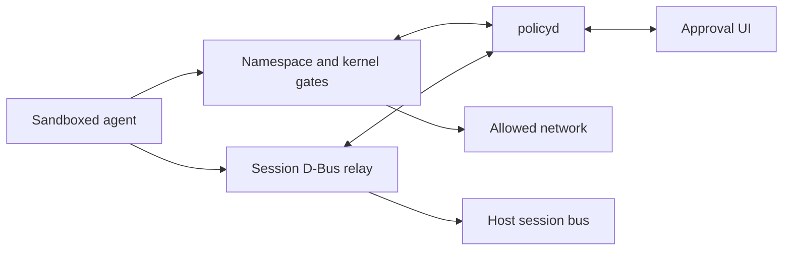

# agent-sandbox

Run AI agent CLIs inside a bubblewrap jail on NixOS. Unknown operations block until you approve them, or fail outright when `agent-sandbox.policy.interactiveApproval = false`.

## What it gates

| Gate | Behavior |
| --- | --- |
| Network | Gives each sandbox its own network namespace and checks outbound TCP and UDP traffic. |
| HTTP proxy | Inspects HTTP/1.0, HTTP/1.1, HTTP/2, and HTTP/3 traffic through a transparent proxy, including WebSocket upgrade relays and WebTransport. |
| Filesystem | Uses static bubblewrap mount isolation by default. Enabling `gates.filesystem.enable` switches to dynamic fanotify approval for file opens, and `gates.filesystem.ignoreStaticAllows` skips the monitor for statically allowed files that nothing can write. |
| Resources | Gates Unix-socket operations and device access under `/dev`. `connect` and `send` are separate permissions. |
| Sudo | Prompts before a command runs as root on the host. A rule such as `["bash"]` grants unrestricted root execution. |
| D-Bus | Filters session and system bus calls through a per-sandbox relay. |

## Binary cache

Cachix hosts prebuilt store paths. Direct users of this flake get the cache from `nixConfig` after accepting the trust prompt. Consuming flakes do not inherit `nixConfig`, so add these settings to your flake:

```nix
nixConfig = {
  extra-substituters = [ "https://agent-sandbox.cachix.org" ];
  extra-trusted-public-keys = [
    "agent-sandbox.cachix.org-1:x7WgdtZjoPgbKdyk5oxP2QvN7B3SfuHmGvXKJ8xtTu0="
  ];
};
```

You can also run `nix run nixpkgs#cachix use agent-sandbox`.

A pre-push hook checks, builds, and publishes the package to Cachix on pushes to `main`. Enable it with `git config core.hooksPath .githooks`. To skip it on one push, run `git push --no-verify`.

## Quick start

```nix
{
  imports = [ inputs.agent-sandbox.nixosModules.agent-sandbox ];

  agent-sandbox = {
    enable = true;
    network.enable = true;
    network.httpProxy.enable = true;
    gates.filesystem.enable = true;
    gates.resources.enable = true;
    gates.syscalls.enable = true;

    packages = [{
      package = inputs.llm-agents.packages.${system}.omp;
      launchHook.sandboxed = ''
        unset XDG_DATA_HOME
        export LD_LIBRARY_PATH="${lib.makeLibraryPath [ pkgs.stdenv.cc.cc.lib ]}''${LD_LIBRARY_PATH:+:$LD_LIBRARY_PATH}"
      '';
      readwriteDirs = [ "~/.omp" ];
    }];
  };
}
```

To gate sudo, set `agent-sandbox.sudoPolicy = "approve"`. On headless systems, set `agent-sandbox.policy.uiBackend = "none"`. The full option reference lives in `nix/modules/nixos/agent-sandbox/agent-sandbox.nix`.

## Package launch hooks and arguments

Each package's `launchHook.sandboxed` runs Bash right before the sandboxed executable starts, inside the sandbox and after credential filtering. It defaults to an empty string and leaves the caller's environment and other packages untouched. In the `omp` example above, the hook keeps data in `~/.omp/agent` and prepends compiler runtime libraries to `LD_LIBRARY_PATH` without dropping existing entries. `blockEnvVars` filters credentials only for sandboxed launches.

To pass fixed arguments before caller arguments, set `launchArgs.sandboxed`:

```nix
agent-sandbox.packages = [{
  package = pkgs.claude-code;
  launchArgs.sandboxed = [ "--dangerously-skip-permissions" ];
  launchHook.unsandboxed = ''
    unset XDG_DATA_HOME
  '';
}];
```

`launchArgs.sandboxed` and `launchHook.sandboxed` apply only to sandboxed launches. `launchArgs.unsandboxed` and `launchHook.unsandboxed` apply only to unsandboxed launches, either through `<unsafeAliasPrefix><binary>` with the default `unsafe-` prefix or through the original binary when `replaceOriginalBinary = false`. The wrapper passes each argument list entry literally without shell expansion. Both argument lists default to empty lists, and both hooks default to empty strings. Unsandboxed hooks run on the host without credential filtering.

Configurations that previously set one `launchHook` for both modes must set both `launchHook.sandboxed` and `launchHook.unsandboxed` to keep that behavior in both modes.

## Networking

### Interception and verdict gate

NFQUEUE intercepts every TCP connection regardless of port and registers the flow for the transparent proxy. The proxy peeks at the first stream bytes to tell TLS and HTTP apart from raw TCP. HTTP and HTTPS take the decoding policy path. The proxy splices everything else end to end after one `tcp://host:port` policy check. A raw TCP prompt also lists other host names that the sandbox resolved to that address.

UDP uses one configured intercept port because a socket must bind each port. The first payload byte chooses the path. QUIC long headers go to the HTTP/3 proxy, and everything else goes to the direct transport check.

For plain HTTP, the proxy resolves host names the same way the sandbox does. It checks `/etc/hosts` first and then queries the sandbox's DNS forwarder. It never uses the host's nscd.

A denied connection fails at once. TCP gets a reset, and UDP gets a port-unreachable error. That denial applies only to that connection. Another sandbox instance connecting to the same address faces its own policy.

`agent-sandbox.network.verdictGate.enable` is on by default and adds a kernel-side decision path above NFQUEUE. The NFQUEUE daemon publishes each replayable destination verdict into a pinned BPF map and reuses it instead of asking `policyd` again. Map entries key on both the connecting sandbox's cgroup and the destination, because sandboxes in different projects or packages merge different policies. A `cgroup/connect4` and `cgroup/connect6` BPF program enforces denials before any packet exists. Each entry carries the generation of the decision set that published it, so withdrawing a grant retires every cached verdict with one write. Missing or stale entries fall back to userspace. The daemon never caches hostname-derived or one-time approvals.

### Share localhost

Sandboxed processes reach every TCP and UDP port on host `127.0.0.1` without extra configuration. Network policy checks each port as `127.0.0.1:<port>`, so an unapproved port prompts like any other destination. A listener inside the sandbox's own namespace wins over the host.

Two cases still need an explicit port list. The host can reach sandbox listeners only on listed ports, and IPv6 `::1` shares only listed ports:

```nix
agent-sandbox.network.loopback = {
  tcpPorts = [ 3080 49600 ];
  udpPorts = [ 5354 ];
};
```

Listed ports skip the policy prompt. A listener in the client's own namespace wins. Otherwise the connection or datagram reaches the listener in the other namespace. No process binds the configured ports, so a host service and a sandbox service can both use the same port.

Host services see sandbox connections as coming from `127.0.0.1`. Direct sandbox connections to the veth gateway at `169.254.100.1` also land on host localhost, except DNS on port 53.

### HTTP proxy

Ordinary HTTPS requests negotiate `h2` or `http/1.1` independently of the downstream HTTP version, while explicit HTTP/1.0 and WebSocket rules still apply. Downstream leaf certificates prefer ECDSA P-256, then P-384, then RSA according to what the client advertises.

#### Upstream protocol overrides

If an upstream WebSocket endpoint rejects HTTP/2 Extended CONNECT, pin that URL pattern to HTTP/1.1:

```nix
agent-sandbox.network.httpProxy.websocketHttp11Urls = [
  "https://api.openai.com/v1/live/rtc_*"
];
```

To allow HTTP/1.0 for an upstream origin, list its canonical origin:

```nix
agent-sandbox.network.httpProxy.http10UpstreamOrigins = [
  "https://legacy.example.com"
];
```

To talk to a cleartext HTTP/2 service, list its exact origin:

```nix
agent-sandbox.network.httpProxy.h2cUpstreamOrigins = [
  "http://grpc.example.com:8080"
];
```

The standalone flag is `--h2c-upstream-origin ORIGIN`. Listed origins use HTTP/2 prior knowledge without HTTP/1 fallback and cannot also appear in `http10UpstreamOrigins`. The proxy accepts downstream cleartext HTTP/2 connections and rejects HTTP/1 `Upgrade: h2c`. Every request still requires HTTP policy approval, including requests on an existing HTTP/2 connection.

#### HTTP/3

HTTP/3 interception stays off unless you enable it:

```nix
agent-sandbox.network.httpProxy.http3 = {
  enable = true;
  altUdpPorts = [ 4444 ];
};
```

To allow more than the default two seconds for upstream QUIC TLS handshakes, raise the timeout:

```nix
agent-sandbox.network.httpProxy.http3.upstreamHandshakeTimeoutMs = 15000;
```

The standalone flag is `--http3-upstream-handshake-timeout-ms MILLISECONDS`.

#### Upstream mTLS

For upstream services that require mTLS, point the proxy at a runtime credentials file:

```nix
agent-sandbox.network.httpProxy.upstreamClientIdentitiesFile = "/run/secrets/proxy-identities.json";
```

The standalone flag is `--upstream-client-identities FILE`. The JSON file holds an array of exact HTTPS origins and PEM file paths:

```json
[
  {
    "origin": "https://api.example.com:8443",
    "certificate": "/run/secrets/api-client-chain.pem",
    "private_key": "/run/secrets/api-client-key.pem"
  }
]
```

Use a leaf-first certificate chain and an unencrypted private key. Set ownership on the JSON file and every PEM file to `agent-sandbox-proxy:agent-sandbox-proxy` with mode `0600`, and make sure that user can traverse every parent directory. Keep private keys outside the Nix store. Relative PEM paths resolve against the JSON file's directory. Restart the proxy after changing credentials. At startup, the proxy rejects invalid keys, mismatched certificates, and duplicate origins.

Credentials apply only to the exact HTTPS host and port on both TCP and HTTP/3. They do not grant policy access and do not forward the downstream client's TLS identity. Other origins receive no client certificate. The proxy rejects wildcards and URL paths.

#### Connection limits and timeouts

The TCP proxy forwards informational responses such as `103 Early Hints` on HTTP/1.1 and HTTP/2 before the final response. It forwards at most 16 upstream interim responses per request and omits them for HTTP/1.0 clients.

Each sandbox instance may hold at most 256 connections to the proxy across TCP and QUIC together. Connections that the proxy cannot attribute to a sandbox share another 256. Over the limit, the proxy refuses new connections and logs a refusal at most once every 30 seconds per sandbox. Use `--max-connections-per-owner` and `--max-unattributed-connections` to change those caps.

The proxy closes a downstream connection after 30 seconds with no open request, excluding time that the sandbox spent frozen. HTTP/2 clients receive `GOAWAY`, and HTTP/1 connections close between requests. If a connection stays open 5 seconds later or stalls on a partial request head, the proxy drops it. An HTTP/1 client may shut down its sending side after sending a request and still read the response. If a client closes or resets its socket while waiting for approval, the proxy withdraws the prompt.

## Policy

Policy layers load in this order, and denies take precedence across all layers:

1. Declarative policy from NixOS.
2. Package policy base, set per package on the host with `--package-declarative`.
3. Package policy home extension at `~/.config/agent-sandbox/packages/<package>.json`.
4. User policy at `~/.config/agent-sandbox/policy.json`.
5. Project policy at `<project_root>/.agent-sandbox/policy.json`.
6. Package project policy at `<project_root>/.agent-sandbox/packages/<package>.json`.
7. Runtime decisions for the current request or session.

Package layers apply only to sandbox instances attributed to that package. Runtime decisions apply after the file layers. The `global`, `global package`, `project`, and `project package` scopes write their rule back to a policy file. The `once` and `session` scopes keep their decision in memory for the current request or session.

Before the agent starts, the launcher registers the sandbox instance with `policyd` and fixes its package and project root. If registration fails, the sandbox does not start. `policyd` keeps registrations across its own restarts and verifies each one against the launcher process before reusing it. Nothing inside the sandbox can change its package or project root. `policyd` ignores environment variables from inside the sandbox, and naming another sandbox's session ID grants none of that sandbox's state.

`once` and `session` runtime decisions belong only to the sandbox instance that triggered them. The short-lived verdicts `policyd` caches for a second or two follow the same rule. An approval in one sandbox never answers the same request from another, and two sandboxes asking for the same operation get separate prompts. A request from outside any sandbox instance never inherits approvals given inside one.

Filesystem paths, network hosts, HTTP URLs, and D-Bus target string fields accept [globset syntax](https://docs.rs/globset/0.4.19/globset/#syntax) in `literal_separator` mode. In `literal_separator` mode, `*` and `?` do not match `/`, so use `**` for recursive path matching. The sandbox blocks reads and writes to policy files, including access through hardlinks.

```json
{
  "network": {
    "direct": {
      "allow": [{ "host": "api.example.com", "port": 443, "comment": "API access" }],
      "deny": []
    },
    "http": {
      "allow": [{
        "methods": ["GET"],
        "url": "https://api.example.com/models",
        "port": 443,
        "comment": "Model listing"
      }],
      "deny": []
    }
  },
  "sudo": {
    "allow": [],
    "deny": []
  },
  "filesystem": {
    "allow": [
      { "path": "~/.cache/example", "access": "read", "comment": "Application cache" }
    ],
    "deny": []
  },
  "resources": {
    "allow": [
      {
        "kind": "unix_socket",
        "path": "/run/user/1000/example.sock",
        "access": "connect",
        "comment": "Example service"
      }
    ],
    "deny": []
  },
  "dbus": {
    "allow": [
      {
        "target": {
          "bus": "session",
          "destination": "org.freedesktop.portal.*",
          "object_path": "/org/freedesktop/portal/desktop",
          "interface": "org.freedesktop.portal.OpenURI",
          "member": "OpenURI",
          "message_kind": "method_call",
          "signature": "ssa{sv}",
          "fd_metadata": []
        },
        "comment": "Desktop portal access"
      }
    ],
    "deny": []
  }
}
```

## D-Bus

Set `agent-sandbox.policy.dbus.enable = true` to expose filtered D-Bus sockets. Enabling D-Bus filtering requires `gates.resources.enable`, which blocks direct host IPC socket connections. The wrapper starts a dedicated relay for each sandbox instance and points `DBUS_SESSION_BUS_ADDRESS` at that relay. `policyd` checks destination, object path, interface, member, message kind, signature, and file-descriptor metadata. It rejects systemd sockets to block escapes such as `systemd-run`.

Destination, object path, interface, member, and signature accept glob patterns, so `"signature": "*"` matches any signature. File-descriptor metadata matches exactly unless a rule sets `"any_fd_metadata": true`. In an approval prompt, enter `*` in the signature or FD metadata field to match any value.

Inside the sandbox, `xdg-open` and `$BROWSER` open URLs in the host browser through the desktop portal, so allow `org.freedesktop.portal.OpenURI.OpenURI` in session policy. When a URL carries an OAuth `redirect_uri` on host loopback, `policyd` forwards that port into the sandbox for up to five minutes so the login callback reaches the agent.

In Home Manager, import `inputs.agent-sandbox.homeModules.agent-sandbox` and set `agent-sandbox.tern-oauth.enable = true`. Without Home Manager, run `tern plugin install ./integrations/tern-oauth`. For Luau completions in Zed, run `tern plugin types integrations/tern-oauth`.

## FUSE mounts

Sandboxed programs can mount FUSE filesystems such as `ovnfs`, `gocryptfs`, `bindfs` and `sshfs`. The sandbox cannot run the setuid `fusermount3`, so each sandbox gets a `fusermount3` and `fusermount` replacement on `PATH` and at `/run/wrappers/bin`. The replacement asks `policyd` to mount. A root helper joins the sandbox's mount namespace and mounts there, so the mount exists only inside that sandbox. The host and other sandboxes never see it.

The mountpoint must be a directory the sandbox user owns, reached without symlinks. Every mount gets `nosuid` and `nodev`, and only the mounting user can use it. `allow_other` works only when the host's `/etc/fuse.conf` sets `user_allow_other`. The helper refuses mountpoints in `/proc`, `/sys`, `/dev`, `/nix/store`, `/run/wrappers` and the shared policy directory. With the filesystem gate on, the mountpoint also needs write access under filesystem policy. `fusermount3 -u` and `-u -z` unmount only the user's own FUSE mounts, dead ones included. Set `agent-sandbox.policy.fuse.enable = false` to turn this off.

## Approval UI and sandbox lifecycle

`agent-sandbox-ui` shows the packaged Qt dialog and falls back to `zenity`. Dialogs open one at a time in the order requests arrived. On systems without a graphical UI, use `agent-sandbox-approve`.

While a filesystem, resource, network, HTTP, D-Bus, or sudo prompt is open, `policyd` freezes the requesting sandbox's systemd scope so the agent stays paused until you decide. An approved sudo command runs after the sandbox thaws. If `policyd` cannot freeze the sandbox, it blocks the request instead of prompting.

A frozen sandbox stops running, but its `CLOCK_MONOTONIC` and `CLOCK_BOOTTIME` clocks keep ticking. Without clock pausing, a QUIC idle timer or a DevTools wait can expire the moment you answer. Set `agent-sandbox.policy.pauseClockWhileFrozen = true` to give every sandbox its own time namespace. Just before thawing the scope, `policyd` rewinds that namespace by the time spent frozen. `policyd` counts from the moment the kernel reports the scope frozen, or from one second after the freeze request if the kernel never reports it. Enabling `pauseClockWhileFrozen` loads the out-of-tree `agent_sandbox_timens` kernel module, built for `boot.kernelPackages`, and requires Linux 6.18 or newer with `CONFIG_TIME_NS` and `network.enable`. The kernel module and `policyd` must come from the same revision. Wall-clock time still advances. A sleep or timer armed before the freeze keeps its original deadline, so it can fire early by up to the frozen duration.

When a systemd user manager is reachable, each sandbox instance runs in its own systemd scope. When the launcher exits, `policyd` kills every process left in that scope, including daemons that the agent detached. A sandbox started without a user manager runs unscoped, and `policyd` logs that it cannot clean up leftover processes.

## Architecture



The workspace splits shared policy types, `policyd`, network enforcement, filesystem monitoring, syscall brokering, and CLI tools into crates under `crates/`.

The filesystem monitor runs up to four workers, each reading one permission event directly from fanotify and deciding it in place. Pending events stay in the kernel queue with no userspace dispatch queue. Policy refresh and shutdown handling run separately from workers waiting on approval.

The syscall broker runs up to two notification consumers, each with its own policy client. The kernel dispatches each paused syscall to one consumer, and authorized filesystem mutations execute from captured arguments.

Literal path resolution can call `openat2(RESOLVE_NO_SYMLINKS)` to prove that a path is already canonical. Aliases and unsupported kernels fall back to the normal resolver. The resolver repeats this lookup for each uncached resolution, and the proof does not grant access or skip deny checks.
